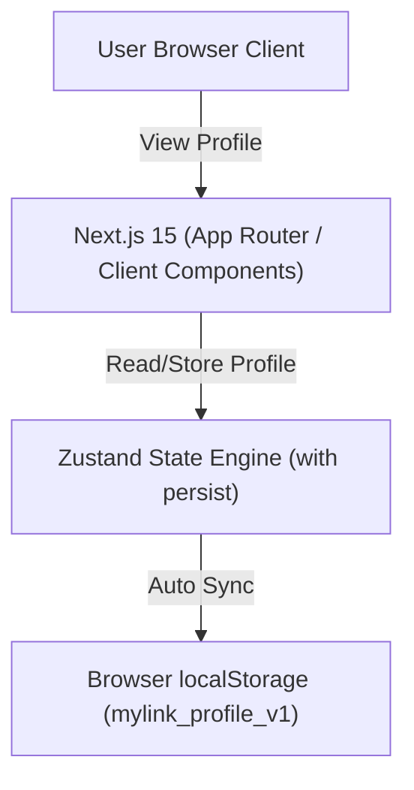
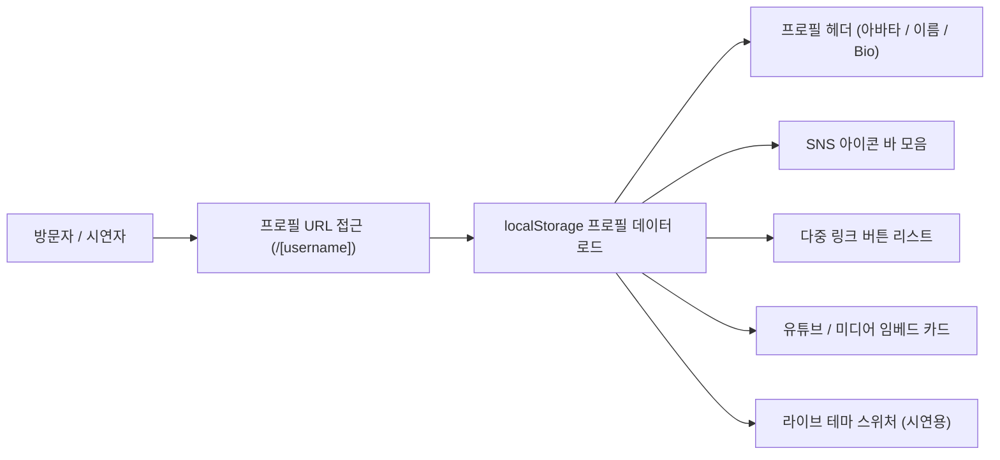

# 📱 마이링크 (MyLink) 제품 기능 정의서 (PRD)

> **문서 버전:** v1.4 (방문자/소유자 구분 시나리오 추가)  
> **작성일:** 2026년 10월 6일  
> **상태:** 승인됨 (Approved)  
> **프로젝트 명:** 마이링크 (MyLink) - 로컬 기반 원링크(Link-in-bio) 크리에이터 서비스  

---

## 1. 프로젝트 개요 (Overview)

### 1.1 목적 및 비전
'마이링크(MyLink)'는 별도의 백엔드 서버 설정 없이 **브라우저 로컬 스토리지(localStorage)**를 활용하여, 크리에이터 및 개인이 단 하나의 프로필 링크(`mylink.com/[username]`)로 자신의 콘텐츠, SNS 채널, 동영상/음악을 매끄럽게 연결할 수 있는 **모바일 최적화 바이오 링크(Link-in-bio) 서비스**입니다.

### 1.2 시연 및 구현 단계 구분 (Step-by-Step Roadmap)
현재 시연 단계에서는 **[1단계: 로컬 스토리지 기반 공개 프로필 페이지]** 구현에 집중하며, 대시보드 및 통계 기능은 차후 단계로 분리하여 진행합니다.

- **🎯 1단계 (현재 진행 범위):** 로컬 스토리지 데이터 기반 모바일 공개 프로필 페이지 MVP (`/[username]`)
- **⌛ 2단계 (다음 예정):** 로컬 링크 & 프로필 블록 편집 대시보드
- **⌛ 3단계 (다음 예정):** 방문자 및 링크 클릭 로컬 통계 분석 기능

---

## 2. 사용자 시나리오 (User Scenarios)

### 👤 A. 프로필 소유자 (Creator / Owner) 시나리오

#### 1. 소유자 시나리오 A1: 다중 링크 & 프로필 통합 구성
- **목적:** 인스타그램, 유튜브, 틱톡 등에 분산된 본인의 채널을 하나의 단축 링크(`mylink.com/username`)로 통합 정리함.
- **시나리오:**
  1. 소유자는 아바타 사진, 디자이너/개발자 표시 이름("홍길동"), 한줄 소개(Bio)를 설정한다.
  2. 주요 기술 블로그, 커리어 이력서, 1:1 커피챗 링크를 로컬 스토리지 데이터로 저장한다.
  3. 인스타그램 프로필 바이오에 해당 단축 프로필 링크를 게재한다.

#### 2. 소유자 시나리오 A2: 실시간 브랜드 디자인 테마 라이브 전환 (시연 기능)
- **목적:** 브랜드 행사나 마케팅 컨셉에 맞춰 프로필 페이지 디자인을 다크 모드나 파스텔 핑크 테마로 자유롭게 전환하여 시연함.
- **시나리오:**
  1. 소유자는 화면 하단의 플로팅 **[테마 스위처 바]**를 클릭한다.
  2. `Toss Blue` ➔ `Modern Dark` ➔ `Soft Pink` ➔ `Minimal White` 테마를 고른다.
  3. 0ms 지연으로 전체 배경색, 버튼 카드 스타일, 폰트 가독성이 라이브로 바뀌는 것을 확인한다.

#### 3. 소유자 시나리오 A3: 미디어 카드(유튜브/음악) 매립 구성
- **목적:** 방문자가 외부 플랫폼으로 이탈하지 않고 프로필 내에서 대표 유튜브 영상이나 추천 음악을 재생하길 원함.
- **시나리오:**
  1. 프로필 하단에 16:9 미디어 플레이어 카드를 배치하여 대표 콘텐츠를 노출한다.

---

### 👁️ B. 프로필 방문자 (Visitor) 시나리오

#### 1. 방문자 시나리오 B1: 모바일 접속 & 소셜 매체 바로가기
- **목적:** 인스타그램 바이오를 거쳐 크리에이터의 다른 소셜 플랫폼으로 손쉽게 이동하고자 함.
- **시나리오:**
  1. 방문자는 모바일 브라우저로 `mylink.com/gildong` 링크에 접근한다.
  2. 프로필 상단의 소셜 아이콘 바(GitHub, Instagram, Email)를 눌러 각 공식 플랫폼으로 바로 연결된다.

#### 2. 방문자 시나리오 B2: 주요 링크 탐색 & 프로필 URL 복사/공유
- **목적:** 크리에이터의 블로그 글이나 이력서를 탐색하고, 프로필 주소를 지인에게 공유하고 싶음.
- **시나리오:**
  1. 방문자는 카드형 버튼("공식 기술 블로그", "GitHub 코드 저장소")을 터치하여 외부 사이트로 연결된다.
  2. 우상단 공유 버튼(Share)을 누르고 "프로필 링크가 복사되었습니다!" 토스트 안내를 확인한 뒤 친구에게 링크를 전달한다.

#### 3. 방문자 시나리오 B3: 프로필 내 미디어 플레이어 인앱 감상
- **목적:** 외부 애플리케이션 전환 없이 마이링크 모바일 화면 안에서 유튜브 영상을 감상함.
- **시나리오:**
  1. 프로필 하단의 "🎬 최근 유튜브 영상 추천" 카드의 재생 버튼을 눌러 모바일 뷰 내에서 영상을 즉시 시청한다.

---

## 3. 기술 스택 및 아키텍처 (Tech Stack)



| 구분 | 기술 스택 / 도구 | 비고 |
| :--- | :--- | :--- |
| **Frontend Framework** | Next.js 15 (App Router), React 19 | Client Components 위주 반응형 구성 |
| **State Management** | **Zustand** (with `persist` middleware) | `localStorage` 데이터 자동 동기화 및 전역 상태 관리 |
| **Styling** | Tailwind CSS, Lucide Icons | 모바일 퍼스트 뷰 & 카드 디자인 |
| **Data & Storage** | Browser `localStorage` | 백엔드 서버 없이 브라우저 단독 저장 |
| **URL 구조** | `mylink.com/[username]` | 동적 라우팅 및 로컬 스토리지 프로필 조회 |

---

## 4. 정보 구조 (IA) 및 사용자 여정 (1단계 범위)



---

## 5. 1단계 상세 기능 명세 (Profile Page MVP)

> **상세 화면 와이어프레임:** 📐 **[wireframe.md](file:///c:/Users/sjmin/Desktop/%EC%B2%AD%EC%9A%B4%EB%8C%80/26%EB%85%84%202%ED%95%99%EA%B8%B0/%EB%B0%94%EC%9D%B4%EB%B8%8C%20%EC%BD%94%EB%94%A9/my-link/docs/wireframe.md)**

### 5.1 프로필 헤더 (Profile Header)
- **아바타 이미지:** 둥근 테두리와 그림자 효과가 적용된 프로필 이미지
- **표시 이름 & 유저네임:** 브랜드/크리에이터 이름과 고유 `@username` 표시
- **바이오 (한줄 소개):** 최대 100자의 짧은 크리에이터 소개글
- **링크 공유 기능:** 상단 공유 버튼 클릭 시 현재 프로필 URL 클립보드 자동 복구

### 5.2 SNS 아이콘 바 (Social Bar)
- 인스타그램, 유튜브, GitHub, 이메일, 트위터 등 주요 SNS 아이콘을 원형 버튼으로 구성
- 클릭 시 해당 플랫폼 URL로 새 탭에서 연결

### 5.3 다중 링크 버튼 리스트 (Link Buttons)
- 제목(Title), 부제목(Subtitle), 아이콘, 뱃지(Badge)를 포함한 카드형 버튼
- 호버 및 터치 시 매끄러운 확대/축소 애니메이션 (Active Scale UI)
- 클릭 시 지정된 핀포인트 외부 URL로 이동

### 5.4 미디어 임베드 카드 (Embed Card)
- 유튜브 영상 URL 입력 시 16:9 비율의 반응형 비디오 플레이어 매립

### 5.5 시연용 테마 스위처 (Theme Switcher)
- 하단 플로팅 툴바를 통해 **Toss Blue / Modern Dark / Soft Pink / Minimal White** 4가지 디자인 테마를 즉시 전환 및 테스트하는 기능

---

## 6. 데이터 스키마 (localStorage Schema)

`localStorage` 키: `mylink_profile_v1`

```json
{
  "state": {
    "profile": {
      "username": "gildong",
      "displayName": "홍길동 (Gildong Hong)",
      "bio": "🎨 디자이너 겸 웹 크리에이터 | 토스 스타일 웹 개발과 일상 기록 🚀",
      "avatarUrl": "https://images.unsplash.com/photo-1534528741775-53994a69daeb?auto=format&fit=crop&w=300&q=80",
      "theme": {
        "preset": "toss-blue",
        "buttonRadius": "full"
      },
      "links": [
        {
          "id": "link-1",
          "title": "공식 기술 블로그 (Velog)",
          "subtitle": "웹 프론트엔드와 최신 디자인 시스템 개발기",
          "url": "https://velog.io",
          "icon": "📝",
          "badge": "주 2회 발행",
          "isActive": true,
          "sortOrder": 0
        }
      ],
      "socials": [
        { "platform": "instagram", "url": "https://instagram.com" },
        { "platform": "youtube", "url": "https://youtube.com" }
      ],
      "embeds": [
        {
          "id": "embed-1",
          "title": "🎬 최근 유튜브 영상 추천",
          "embedUrl": "https://www.youtube.com/embed/dQw4w9WgXcQ",
          "platform": "youtube",
          "isActive": true
        }
      ]
    }
  },
  "version": 0
}
```

---

## 7. 단계별 이행 로드맵 (Milestones)

| 단계 | 개발 범위 | 상태 |
| :--- | :--- | :--- |
| **1단계 (MVP)** | **로컬 스토리지 기반 공개 프로필 페이지 (`/[username]`)** | **완료 (시연 가능)** |
| **2단계** | 프로필 및 링크 블록 실시간 드래그 앤 드롭 편집 대시보드 | 대기 |
| **3단계** | 로컬 방문자 수 및 링크 클릭률 통계 리포트 | 대기 |
