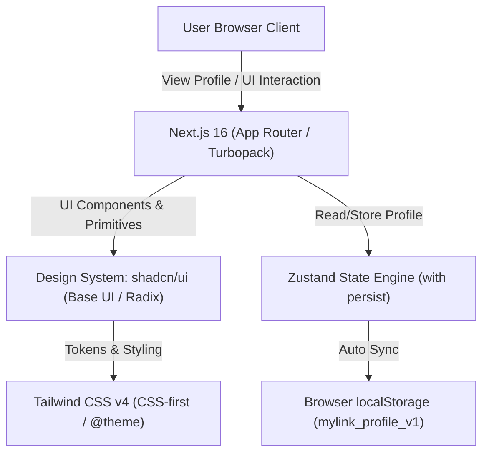
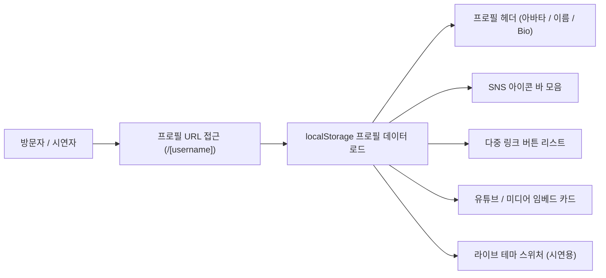

# 📱 마이링크 (MyLink) 제품 기능 정의서 (PRD)

> **문서 버전:** v1.9 (프로필 카드 패널 래퍼 레이아웃 추가 및 다크 모드 임베드 카드 시각성 강화)  
> **최종 수정일:** 2026년 11월 8일  
> **상태:** 승인됨 (Approved)  
> **프로젝트 명:** 마이링크 (MyLink) - 로컬 기반 원링크(Link-in-bio) 크리에이터 서비스  

---

## 1. 프로젝트 개요 (Overview)

### 1.1 목적 및 비전
'마이링크(MyLink)'는 별도의 백엔드 서버 설정 없이 **브라우저 로컬 스토리지(localStorage)**를 활용하여, 크리에이터 및 개인이 단 하나의 프로필 링크(`mylink.com/[username]`)로 자신의 콘텐츠, SNS 채널, 동영상/음악을 매끄럽게 연결할 수 있는 **모바일 최적화 바이오 링크(Link-in-bio) 서비스**입니다.

### 1.2 시연 및 구현 단계 구분 (Step-by-Step Roadmap)
현재 시연 단계에서는 **[1단계: 로컬 스토리지 기반 공개 프로필 페이지]** 구현에 집중하며, 대시보드 및 통계 기능은 차후 단계로 분리하여 진행합니다.

- **🎯 1단계 (현재 진행 범위):** 로컬 스토리지 데이터 기반 모바일 공개 프로필 페이지 MVP (`/[username]`)
- **⌛ 2단계 (다음 예정):** 로컬 링크 & 프로필 블록 편집 대시보드
- **⌛ 3단계 (다음 예정):** 방문자 및 링크 클릭 로컬 통계 분석 기능

---

## 2. 사용자 시나리오 (User Scenarios)

### 👤 A. 프로필 소유자 (Creator / Owner) 시나리오

#### 1. 소유자 시나리오 A1: 다중 링크 & 프로필 통합 구성
- **목적:** 인스타그램, 유튜브, 틱톡 등에 분산된 본인의 채널을 하나의 단축 링크(`mylink.com/username`)로 통합 정리함.
- **시나리오:**
  1. 소유자는 아바타 사진, 디자이너/개발자 표시 이름("홍길동"), 한줄 소개(Bio)를 설정한다.
  2. 주요 기술 블로그, 커리어 이력서, 1:1 커피챗 링크를 로컬 스토리지 데이터로 저장한다.
  3. 인스타그램 프로필 바이오에 해당 단축 프로필 링크를 게재한다.

#### 2. 소유자 시나리오 A2: 실시간 브랜드 디자인 테마 라이브 전환 (시연 기능)
- **목적:** 브랜드 행사나 마케팅 컨셉에 맞춰 프로필 페이지 디자인을 다크 모드나 파스텔 핑크 테마로 자유롭게 전환하여 시연함.
- **시나리오:**
  1. 소유자는 화면 하단의 플로팅 **[테마 스위처 바]**를 클릭한다.
  2. `Toss Blue` ➔ `Modern Dark` ➔ `Soft Pink` ➔ `Minimal White` 테마를 고른다.
  3. 0ms 지연으로 전체 배경색, 버튼 카드 스타일, 폰트 가독성이 라이브로 바뀌는 것을 확인한다.

#### 3. 소유자 시나리오 A3: 미디어 카드(유튜브/음악) 매립 구성
- **목적:** 방문자가 외부 플랫폼으로 이탈하지 않고 프로필 내에서 대표 유튜브 영상이나 추천 음악을 재생하길 원함.
- **시나리오:**
  1. 프로필 하단에 16:9 미디어 플레이어 카드를 배치하여 대표 콘텐츠를 노출한다.

---

### 👁️ B. 프로필 방문자 (Visitor) 시나리오

#### 1. 방문자 시나리오 B1: 모바일 접속 & 소셜 매체 바로가기
- **목적:** 인스타그램 바이오를 거쳐 크리에이터의 다른 소셜 플랫폼으로 손쉽게 이동하고자 함.
- **시나리오:**
  1. 방문자는 모바일 브라우저로 `mylink.com/gildong` 링크에 접근한다.
  2. 프로필 상단의 소셜 아이콘 바(GitHub, Instagram, Email)를 눌러 각 공식 플랫폼으로 바로 연결된다.

#### 2. 방문자 시나리오 B2: 주요 링크 탐색 & 프로필 URL 복사/공유
- **목적:** 크리에이터의 블로그 글이나 이력서를 탐색하고, 프로필 주소를 지인에게 공유하고 싶음.
- **시나리오:**
  1. 방문자는 카드형 버튼("공식 기술 블로그", "GitHub 코드 저장소")을 터치하여 외부 사이트로 연결된다.
  2. 우상단 공유 버튼(Share)을 누르고 "프로필 링크가 복사되었습니다!" 토스트 안내를 확인한 뒤 친구에게 링크를 전달한다.

#### 3. 방문자 시나리오 B3: 프로필 내 미디어 플레이어 인앱 감상
- **목적:** 외부 애플리케이션 전환 없이 마이링크 모바일 화면 안에서 유튜브 영상을 감상함.
- **시나리오:**
  1. 프로필 하단의 "🎬 최근 유튜브 영상 추천" 카드의 재생 버튼을 눌러 모바일 뷰 내에서 영상을 즉시 시청한다.

---

## 3. 기술 스택 및 아키텍처 (Tech Stack)



| 구분 | 기술 스택 / 도구 | 비고 |
| :--- | :--- | :--- |
| **Frontend Framework** | **Next.js 16** (App Router), **React 19** | Client Components 위주 반응형 구성 |
| **Design System / UI** | **[shadcn/ui](https://ui.shadcn.com/)** + **토스 디자인 시스템 (TDS)** | shadcn/ui 컴포넌트 아키텍처 위에 [design.md](file:///c:/Users/sjmin/Desktop/%EC%B2%AD%EC%9A%B4%EB%8C%80/26%EB%85%84%202%ED%95%99%EA%B8%B0/%EB%B0%94%EC%9D%B4%EB%B8%8C%20%EC%BD%94%EB%94%A9/my-link/design.md)의 TDS 토큰·비주얼·인터랙션을 결합하여 구축 |
| **Styling** | **Tailwind CSS v4 (단일화)**, Lucide Icons | 모듈 CSS(`*.module.css`) 배제 및 Tailwind CSS 단일화, CSS-First (`@theme`), Zero-config, TDS 색상/라디우스/음영 토큰화 |
| **State Management** | **Zustand** (with `persist` middleware) | `localStorage` 데이터 자동 동기화 및 전역 상태 관리 |
| **Data & Storage** | Browser `localStorage` | 백엔드 서버 없이 브라우저 단독 저장 |
| **URL 구조** | `mylink.com/[username]` | 동적 라우팅 및 로컬 스토리지 프로필 조회 |

### 3.1 shadcn/ui 기반 토스 디자인 시스템(TDS) 구축 원칙
마이링크의 디자인 시스템은 **[shadcn/ui](https://ui.shadcn.com/)**의 견고한 컴포넌트 아키텍처(WAI-ARIA 접근성, headless primitive, 모듈성)를 뼈대로 삼고, 그 위에 **[design.md](file:///c:/Users/sjmin/Desktop/%EC%B2%AD%EC%9A%B4%EB%8C%80/26%EB%85%84%202%ED%95%99%EA%B8%B0/%EB%B0%94%EC%9D%B4%EB%B8%8C%20%EC%BD%94%EB%94%A9/my-link/design.md)에 정의된 토스 디자인 시스템(TDS)의 시각 언어와 인터랙션**을 완벽하게 이식하여 구축한다.

#### 1. 비주얼 철학 및 톤앤매너 (Brand & Mood)
- **무채색 캔버스 & 단일 강조색:** 차갑고 정제된 쿨 그레이(`grey-900` ~ `grey-50`) 배경 위에, 화면당 단 하나의 가장 중요한 주요 CTA에만 선명한 카노니컬 **토스 블루(`blue-500` #3182F6 / `oklch(0.620 0.191 258)`)**를 부여한다.
- **공격적이지만 귀엽지 않은 라운드:** 모서리 반경은 버튼·카드 16px~24px(`radius-xl`~`radius-3xl`), 칩스·캡슐·Primary CTA는 999px(`radius-full`)을 채택하며 인위적인 squircle을 피하고 단단한 기하학적 곡률을 유지한다.
- **친근하고 명확한 보이스 (Voice & Tone):** 일상적이고 명확한 대화형 존댓말 **해요체**를 기본 어조로 통일한다.

#### 2. 핵심 UI 컴포넌트별 TDS 매핑 규격
| shadcn/ui 컴포넌트 | TDS 스타일 및 인터랙션 구현 가이드라인 | 디자인 토큰 연계 |
| :--- | :--- | :--- |
| **Button** (`components/ui/button.tsx`) | • **Primary:** `bg-tds-blue-500 hover:bg-tds-blue-600` 단일 CTA, 풀 필(999px) 또는 16px 라운드<br>• **Secondary:** `bg-tds-grey-100 text-tds-grey-800 hover:bg-tds-grey-200`<br>• **인터랙션:** `active:scale-[0.98]` 누름 반응 및 `press-overlay` 틴트 적용 | `blue-500`, `blue-600`, `grey-100`, `radius-full` |
| **Card** (`components/ui/card.tsx`) | • 쿨 그레이 배경(`grey-100`) 위 순백색(`white`) 또는 미세 경계선(`line-subtle`) 카드<br>• 16px~20px의 넉넉한 여백과 20px~24px 라운드(`radius-2xl`), 은은한 그림자(`shadow-1`) | `tds-bg-elevated`, `line-subtle`, `radius-2xl` |
| **Dialog / Drawer / Sheet** | • 모바일 친화적인 **바텀시트(Drawer)** 형태 기본 채택<br>• 상단 모서리 20~24px 라운드, 스크림 오버레이(`bg-overlay`: 56% 딤), 헤더 내 간결한 제목과 닫기 인터랙션 | `bg-overlay`, `radius-2xl`, `shadow-3` |
| **Badge** (`components/ui/badge.tsx`) | • 알약 형태(`radius-full`)의 캡슐 뱃지<br>• 브랜드 위크(`blue-50` `#E8F3FF` 배경 + `blue-500` 텍스트), `label-s`(13px semibold) | `blue-50`, `blue-500`, `radius-full` |
| **Input / Form** (`components/ui/input.tsx`) | • 포커스 시 토스 블루 테두리(`border-tds-blue-500` / `ring-tds-blue-500/20`), 12px 라운드(`radius-m`)<br>• 플레이스홀더 `tds-fg-quaternary`, 기본 텍스트 `grey-900` | `border-primary`, `radius-m`, `fg-quaternary` |
| **Toast** (`components/ui/sonner.tsx`) | • 플로팅 토스트, 하단 고정, 고대비 다크 서피스(`grey-900`) 또는 라이트 서피스<br>• 깊이감 있는 그림자(`shadow-toast`: `0 8px 24px`), 14px 라운드 | `shadow-toast`, `grey-900` |

#### 3. 타이포그래피 및 토큰 체계
- **서체:** `Pretendard Variable` (폴백: -apple-system, BlinkMacSystemFont, "SF Pro Text", "Apple SD Gothic Neo", "Noto Sans KR", Roboto, sans-serif)
- **자간 및 위계:** `-0.005em` ~ `-0.02em`의 촘촘하고 단단한 자간 적용 (`display-1~2`, `h1~h4`, `title-1~2`, `body-1~3`, `label-l~s`, `caption`)
- **Tailwind CSS v4 통합:** `src/app/globals.css`의 `@theme inline`에 TDS 컬러 변수와 shadcn/ui 테마 변수를 바인딩하여, 컴포넌트 호출 시 자동으로 토스 디자인 시스템 룩앤필이 발현되도록 구축한다.

#### 4. 스타일링 원칙: Tailwind CSS 단일화 (CSS Modules 배제)
- **원칙:** 프로젝트의 모든 화면 및 컴포넌트 스타일링은 **모듈 CSS(`*.module.css`)를 일절 사용하지 않고, 오직 Tailwind CSS v4 유틸리티 클래스로 100% 통일**하여 작성한다.
- **배경 및 이점:**
  1. **일관된 디자인 토큰 제어:** TDS 컬러 및 테마 변수를 `@theme inline` 및 Tailwind 클래스로 바인딩하여 컴포넌트 간 스타일 파편화를 원천 차단.
  2. **유지보수성 & 생산성:** 별도의 CSS 모듈 파일 생성 및 클래스네임 바인딩 오버헤드 없이, shadcn/ui CVA(`cva`) 패턴 및 Tailwind 유틸리티 조합(`cn(...)`)으로 컴팩트하고 선언적인 스타일링 완성.
  3. **반응형 및 동적 테마 최적화:** `active:scale-[0.98]`, `backdrop-blur-md`, 다크 모드(`dark:*`) 등의 인터랙션을 Tailwind 클래스로 통일 관리.

---

## 4. 정보 구조 (IA) 및 사용자 여정 (1단계 범위)



---

## 5. 1단계 상세 기능 명세 (Profile Page MVP)

> **상세 화면 와이어프레임:** 📐 **[wireframe.md](file:///c:/Users/sjmin/Desktop/%EC%B2%AD%EC%9A%B4%EB%8C%80/26%EB%85%84%202%ED%95%99%EA%B8%B0/%EB%B0%94%EC%9D%B4%EB%B8%8C%20%EC%BD%94%EB%94%A9/my-link/docs/wireframe.md)**

### 5.1 프로필 헤더 (Profile Header)
- **아바타 (shadcn/ui Avatar):** `96px * 96px` 원형 아바타, TDS 링 테두리(`ring-4 ring-blue-500/20`)와 우측 하단 반짝임 뱃지 지원
- **표시 이름 & 유저네임:** TDS `h2`(24px bold) 표시 이름과 `label-s` 모노스페이스 `@username`
- **바이오 (한줄 소개):** 최대 100자 가독성 중심 중앙 정렬 (`body-2`, 15px)
- **링크 공유 (shadcn/ui Button + Toast):** 상단 공유 버튼 클릭 시 프로필 URL 클립보드 복사 및 TDS 스타일 토스트("프로필 링크가 복사되었습니다! ✨") 출력

### 5.2 SNS 아이콘 바 (Social Bar)
- **컴포넌트:** shadcn/ui Button (Icon / Ghost 변형) 기반 원형 버튼
- **인터랙션:** 터치 및 호버 시 매끄러운 확대(`scale-110`) 및 블러 배경(`backdrop-blur-md`)
- **지원 채널:** Instagram, YouTube, GitHub, Email, Twitter 등 주요 플랫폼 새 탭 연결

### 5.3 다중 링크 버튼 리스트 (Link Buttons)
- **컴포넌트:** shadcn/ui Card + Badge 기반 리스트 카드
- **구조:** `[좌측 아이콘 + 제목(title-2) / 부제목(caption)] --- [우측 알약형 TDS Badge + 외부링크 아이콘]`
- **TDS 인터랙션:** 터치/클릭 시 누름 효과(`active:scale-[0.98]`, `press-overlay`), 부드러운 호버 전환
- **시연 및 테스트용 표준 더미 데이터셋 활용:** 개발, 테스트 및 데모 시연을 위해 8종의 표준 링크 더미 데이터셋([mock-links.json](file:///c:/Users/sjmin/Desktop/%EC%B2%AD%EC%9A%B4%EB%8C%80/26%EB%85%84%202%ED%95%99%EA%B8%B0/%EB%B0%94%EC%9D%B4%EB%B8%8C%20%EC%BD%94%EB%94%A9/my-link/src/data/mock-links.json))을 기본 활용함 (GitHub 프로필, 커리어 이력, 기술 개발 블로그, 이메일 문의, 오로라 대시보드 데모, 포트폴리오 PDF 다운로드, 소셜미디어, 카카오톡 오픈채팅).

### 5.4 미디어 임베드 카드 (Embed Card)
- **컴포넌트:** shadcn/ui Card 기반 미디어 컨테이너
- **비율:** 16:9 반응형 비디오 플레이어 매립 (`aspect-video rounded-2xl`)

### 5.5 시연용 테마 스위처 (Theme Switcher)
- **컴포넌트:** 하단 플로팅 툴바 (shadcn/ui Toggle/Capsule 버튼 기반)
- **프리셋:** **Toss Blue (기본) / Modern Dark / Soft Pink / Minimal White** 4가지 테마를 0ms 지연으로 실시간 전환 및 테스트

---

## 6. 데이터 스키마 및 더미 데이터 (Data & Mock API Spec)

### 6.1 localStorage 프로필 스키마
`localStorage` 키: `mylink_profile_v1`

```json
{
  "state": {
    "profile": {
      "username": "gildong",
      "displayName": "홍길동 (Gildong Hong)",
      "bio": "🎨 디자이너 겸 웹 크리에이터 | 토스 스타일 웹 개발과 일상 기록 🚀",
      "avatarUrl": "https://images.unsplash.com/photo-1534528741775-53994a69daeb?auto=format&fit=crop&w=300&q=80",
      "theme": {
        "preset": "toss-blue",
        "buttonRadius": "full"
      },
      "links": [
        {
          "id": "link-1",
          "title": "공식 기술 블로그 (Velog)",
          "subtitle": "웹 프론트엔드와 최신 디자인 시스템 개발기",
          "url": "https://velog.io",
          "icon": "📝",
          "badge": "주 2회 발행",
          "isActive": true,
          "sortOrder": 0
        }
      ],
      "socials": [
        { "platform": "instagram", "url": "https://instagram.com" },
        { "platform": "youtube", "url": "https://youtube.com" }
      ],
      "embeds": [
        {
          "id": "embed-1",
          "title": "🎬 최근 유튜브 영상 추천",
          "embedUrl": "https://www.youtube.com/embed/dQw4w9WgXcQ",
          "platform": "youtube",
          "isActive": true
        }
      ]
    }
  },
  "version": 0
}
```

### 6.2 링크 목록 표준 더미 데이터 및 백엔드 Mock API 규격
개발·테스트 및 향후 백엔드 API 연동을 대비하여, 표준 REST API 규격의 더미 데이터 파일([src/data/mock-links.json](file:///c:/Users/sjmin/Desktop/%EC%B2%AD%EC%9A%B4%EB%8C%80/26%EB%85%84%202%ED%95%99%EA%B8%B0/%EB%B0%94%EC%9D%B4%EB%B8%8C%20%EC%BD%94%EB%94%A9/my-link/src/data/mock-links.json))을 정의하여 사용한다.

#### 1. 8종 표준 링크 더미 데이터셋 구성
| 순번 | 타이틀 | 상세 설명 (Subtitle) | 아이콘 | 뱃지 | 카테고리 | 목적 및 비고 |
| :---: | :--- | :--- | :---: | :---: | :---: | :--- |
| **1** | **GitHub 프로필** | 오픈소스 프로젝트 기여 및 개인 코드 저장소 모음 | 🐙 | `50+ Repos` | `tech` | 개발자 코드 역량 및 저장소 노출 |
| **2** | **경력사항 & 커리어 이력** | 담당 프로젝트 및 프론트엔드 개발 상세 이력서 | 💼 | `경력 요약` | `career` | 채용 담당자 및 비즈니스 네트워킹 |
| **3** | **기술 개발 블로그** | 웹 최적화 및 모던 프론트엔드 개발 아티클 | 📝 | `주 2회 연재` | `tech` | 전문 지식 큐레이션 및 글 공유 |
| **4** | **이메일 문의하기** | 협업, 프로젝트 외주 및 채용 관련 편하게 메일 주세요 | ✉️ | `빠른 회신` | `contact` | `mailto:` 스킴 활용 직접 커뮤니케이션 |
| **5** | **오로라 대시보드 데모** | 실시간 데이터 분석 및 인터랙티브 차트 웹 앱 시연 | 📊 | `LIVE DEMO` | `project` | 핵심 인터랙티브 프로젝트 시연 데모 |
| **6** | **포트폴리오 PDF 다운로드** | 2026 최신 작업물 & 핵심 역량 요약본 (고화질 PDF) | 📥 | `PDF` | `portfolio` | 오프라인 문서 및 출력용 포트폴리오 |
| **7** | **소셜 미디어 (X & 인스타그램)** | 개발 트렌드 큐레이션 및 일상 소통 피드 | 📱 | `Daily` | `social` | SNS 팔로워 유입 및 데일리 소통 |
| **8** | **카카오톡 1:1 오픈채팅** | 실시간 질문, 커피챗 및 캐주얼한 대화 환영 | 💬 | `실시간` | `contact` | 캐주얼 실시간 네트워킹 및 Q&A |

#### 2. Mock API 응답 규격 및 데이터 모델 (`src/data/mock-links.json`)
```json
{
  "status": 200,
  "success": true,
  "message": "링크 목록을 성공적으로 조회했습니다.",
  "data": [
    {
      "id": "link-1",
      "title": "GitHub 프로필",
      "subtitle": "오픈소스 프로젝트 기여 및 개인 코드 저장소 모음",
      "url": "https://github.com",
      "icon": "🐙",
      "badge": "50+ Repos",
      "isActive": true,
      "sortOrder": 0,
      "clickCount": 1580,
      "category": "tech",
      "createdAt": "2026-01-10T09:00:00.000Z",
      "updatedAt": "2026-03-01T15:20:00.000Z"
    }
    /* ... link-2 ~ link-8 */
  ],
  "meta": {
    "totalCount": 8,
    "activeCount": 8,
    "page": 1,
    "limit": 20,
    "timestamp": "2026-11-03T02:12:00.000Z"
  }
}
```

#### 3. Mock API 데이터 필드 명세
- **`id` (string)**: 링크 고유 식별자 (예: `link-1`)
- **`title` (string)**: 링크 메인 타이틀
- **`subtitle` (string, optional)**: 링크 보조 설명 문구
- **`url` (string)**: 이동 대상 외부 URL 또는 스킴 (`https://`, `mailto:`)
- **`icon` (string, optional)**: 링크 앞단 노출 이모지 또는 아이콘
- **`badge` (string, optional)**: 우측 알약 형태 TDS 캡슐 뱃지 텍스트
- **`isActive` (boolean)**: 링크 활성화 여부
- **`sortOrder` (number)**: 정렬 순서 (0-based)
- **`clickCount` (number)**: 누적 클릭 수 (백엔드 통계 필드)
- **`category` (string)**: 링크 분류 (`tech`, `career`, `contact`, `project`, `portfolio`, `social`)
- **`createdAt` / `updatedAt` (ISO 8601 string)**: 생성 및 수정 타임스탬프


---

## 7. 단계별 이행 로드맵 (Milestones)

| 단계 | 개발 범위 | 상태 |
| :--- | :--- | :--- |
| **1단계 (MVP)** | **로컬 스토리지 기반 공개 프로필 페이지 (`/[username]`)** | **완료 (시연 가능)** |
| **2단계** | 프로필 및 링크 블록 실시간 편집 대시보드 (shadcn/ui 폼·모달·드래그앤드롭 기반) | 대기 |
| **3단계** | 로컬 방문자 수 및 링크 클릭률 통계 리포트 (shadcn/ui 카드·차트 기반) | 대기 |
