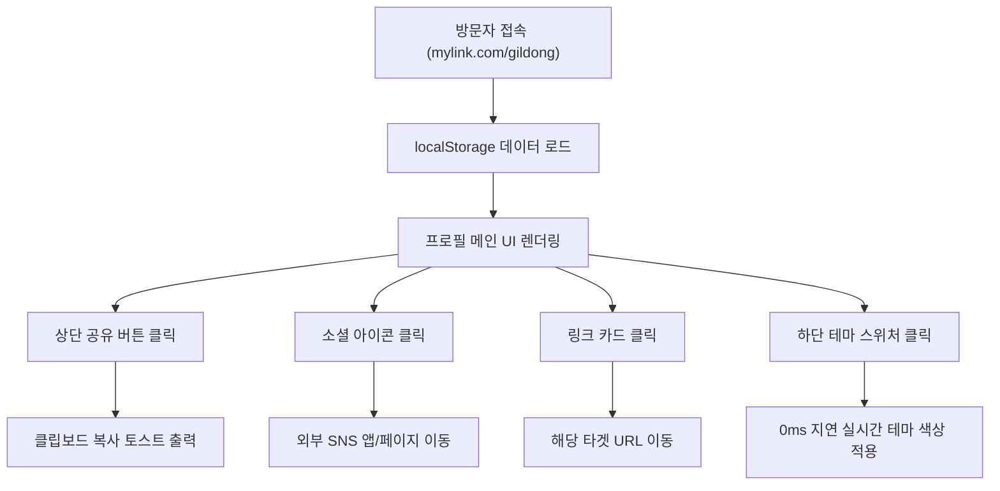

# 📐 마이링크 (MyLink) 메인 프로필 화면 와이어프레임 (Wireframe)

> **대상 화면:** 공개 프로필 뷰어 (`mylink.com/[username]`)  
> **디자인 스펙:** 모바일 퍼스트 (Mobile-First, 390px ~ 430px 규격 최적화)  
> **스타일 기조:** 토스 스타일 (Toss Design System - 깔끔함, 여백 중심, 둥근 모서리, 명확한 터치 피드백)  

---

## 1. 모바일 뷰포트 아스키 와이어프레임 (ASCII Layout)

```text
+-------------------------------------------------------------+
|                                              [  공유 ↗ ]    |  <-- 1. 상단 액션 (클립보드 복사)
|                                                             |
|                        (  아바타  )                         |  <-- 2. 프로필 아바타 (Circle Avatar)
|                           ( ✨ )                            |
|                                                             |
|                   홍길동 (Gildong Hong)                     |  <-- 3. 표시 이름 (Display Name)
|                        @gildong                             |  <-- 4. 유저네임 핸들 (Handle)
|                                                             |
|     🎨 디자이너 겸 웹 크리에이터 | 토스 스타일 웹 개발과 일상    |  <-- 5. 한줄 소개 (Bio)
|                                                             |
|          [ 📷 ]    [ ▶ ]    [ 🐙 ]    [ ✉️ ]                |  <-- 6. 소셜 아이콘 바 (Social Bar)
|        (Instagram)(YouTube)  (GitHub)  (Email)              |
|                                                             |
|  +-------------------------------------------------------+  |  <-- 7. 다중 링크 카드 리스트
|  | [📝] 공식 기술 블로그 (Velog)           [주 2회]  [↗] |  |     (Icon + Title + Subtitle + Badge)
|  |      웹 프론트엔드와 최신 디자인 시스템 개발기          |  |
|  +-------------------------------------------------------+  |
|                                                             |
|  +-------------------------------------------------------+  |
|  | [🐙] GitHub 코드 저장소                [50+ Repos][↗] |  |
|  |      Next.js 및 토스 스타일 오픈소스 프로젝트 모음    |  |
|  +-------------------------------------------------------+  |
|                                                             |
|  +-------------------------------------------------------+  |
|  | [💼] LinkedIn 비즈니스 이력서           [연락 가능][↗] |  |
|  |      글로벌 커리어 및 경력 이력 확인하기              |  |
|  +-------------------------------------------------------+  |
|                                                             |
|  +-------------------------------------------------------+  |
|  | [☕] 1:1 커피챗 신청하기               [신청 가능][↗] |  |
|  |      웹 개발 & 커리어 관련 편하게 소통해요             |  |
|  +-------------------------------------------------------+  |
|                                                             |
|  🎬 최근 유튜브 영상 추천                                   |  <-- 8. 미디어 임베드 카드
|  +-------------------------------------------------------+  |     (Title + 16:9 Iframe Player)
|  |                                                       |  |
|  |                   [ ▶ PLAY VIDEO ]                    |  |
|  |                    (16:9 비디오)                      |  |
|  |                                                       |  |
|  +-------------------------------------------------------+  |
|                                                             |
|                     Powered by MyLink                       |  <-- 9. 브랜드 푸터
+-------------------------------------------------------------+
|  [🎨 시연 테마: Toss Blue | Dark | Soft Pink | Minimal ]    |  <-- 10. 플로팅 테마 스위처 바
+-------------------------------------------------------------+
```

---

## 2. 화면 주요 컴포넌트 명세 (Component Details)

### ① 상단 우측 공유 버튼 (Share Action)
- **위치:** 프로필 상단 우측 고정
- **동작:** 클릭 시 현재 접속 중인 프로필 URL(`mylink.com/gildong`)이 클립보드에 복사되며, **"프로필 링크가 복사되었습니다! ✨"** 하단 토스트 팝업 2초간 출력

### ② 프로필 아바타 & 뱃지 (Profile Avatar)
- **크기:** `96px * 96px` (원형 `rounded-full`)
- **디자인:** 토스 블루 링 테두리(`ring-4 ring-blue-500/20`)와 우측 하단 반짝임 뱃지 지원

### ③ 프로필 정보 (Profile Info)
- **표시 이름:** 굵은 24px 볼드 폰트 (`font-bold text-2xl`)
- **유저네임:** `@gildong` 형태의 모노스페이스 폰트 (`font-mono text-sm opacity-70`)
- **바이오 (Bio):** 최대 100자 가독성 중심 중앙 정렬 (`max-w-sm text-sm opacity-85`)

### ④ 소셜 아이콘 바 (Social Bar)
- **종류:** Instagram, YouTube, GitHub, Email, Twitter 등
- **디자인:** `p-3 rounded-full` 반투명 가래서 배경 (`backdrop-blur-md shadow-sm`), 마우스 호버 및 터치 시 `scale-110` 반응

### ⑤ 다중 링크 카드 (Link Cards)
- **구조:** `[좌측 아이콘 + 제목/부제목 컴포넌트] ------ [우측 뱃지 + 외부링크 화살표]`
- **상태 애니메이션:** 클릭/터치 시 `active:scale-[0.98]` 누름 효과
- **뱃지:** 파란색 연한 배경의 알약 뱃지 (`bg-blue-50 text-blue-600`)

### ⑥ 미디어 임베드 카드 (Embed Card)
- **비율:** 16:9 반응형 아스펙트 레이시오 (`aspect-video rounded-xl`)
- **기능:** 인앱 비디오 바로 재생 지원

### ⑦ 플로팅 테마 스위처 (Floating Theme Switcher)
- **위치:** 모바일 화면 하단 중앙 (`fixed bottom-4 left-1/2 -translate-x-1/2`)
- **테마 프리셋:**
  - `Toss Blue`: 배경 `#F2F4F6`, 카드 `#FFFFFF`
  - `Modern Dark`: 배경 `#090D16`, 카드 `#1F2937`
  - `Soft Pink`: 파스텔 분홍 그라데이션
  - `Minimal White`: 깔끔한 테두리 중심 디자인

---

## 3. 와이어프레임 동적 흐름도 (Mermaid Diagram)


